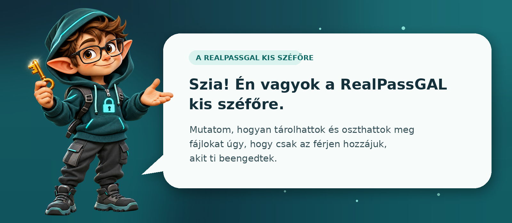
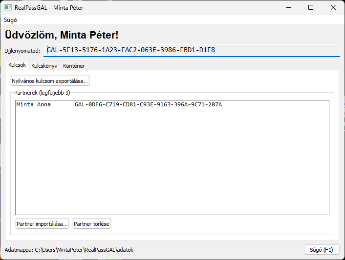
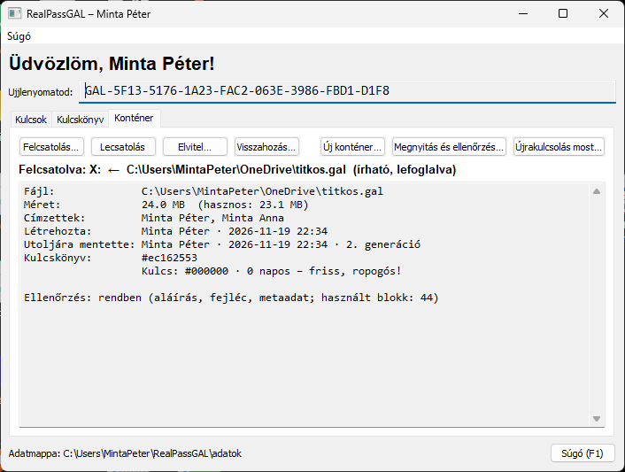
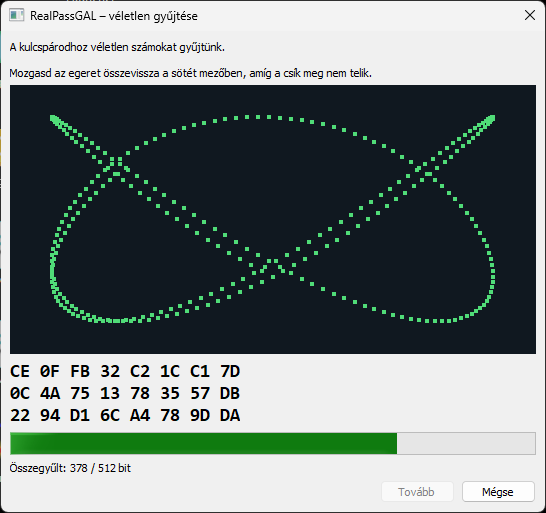
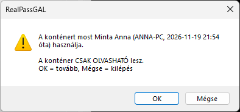

# RealPassGAL

**Egy fájl. Két lakat. Csak azok nyitják ki, akiket te beengedsz.**

A RealPassGAL egy zsebre tehető, titkosított széf Windowsra. Egyetlen `.gal` fájl, amely lehet a gépeden, pendrive-on vagy a OneDrive-on. Kulcs nélkül értelmetlen adathalmaz; a kulcsoddal meghajtóként nyílik meg az Intézőben és a Total Commanderben. Akár négyen is használhatjátok közösen, mindenki a saját kulcsával.

🌐 **Weboldal és útmutató:** https://gali-master.github.io/RealPassGAL/

## Letöltés és telepítés

1. Töltsd le a **[telepito.bat](https://github.com/gali-master/RealPassGAL/releases/latest/download/telepito.bat)** fájlt, és indítsd el.
2. A telepítő megkérdezi, hova tegye a programot, letölti a legfrissebb kiadást, **ellenőrzi az ellenőrzőösszegét**, és ha kell, telepíti a WinFsp illesztőt is.
3. Frissítésnél ugyanígy futtasd: a kulcsaidhoz (`adatok` mappa) nem nyúl.

Kézi telepítés: a [Kiadások](https://github.com/__FELHASZNALO/RealPassGAL/releases/latest) oldalon a `RealPassGAL.zip` tartalmazza a kész `RealPassGAL.exe`-t, a bemutató hangjait, az útmutatót és a WinFsp telepítőjét.

## Mit tud?

- **Hibrid kulcs:** saját kulcspár (X25519 + Ed25519) **és** egy személyesen, pendrive-on cserélt kulcskönyv (1 048 576 kulcs). A kulcspárt a jelszavad védi (Argon2id).
- **Meghajtóként nyílik** (WinFsp), választható betűvel; automatikus mentés, áramszünet-biztos írás.
- **Blokkonkénti titkosítás és ellenőrzés** (XChaCha20-Poly1305), fájlonként SHA-256.
- **Foglalás:** ha a partnered dolgozik benne, nálad csak olvasható – nem írjátok felül egymást.
- **Elvitel / visszahozás**, **30 naponta friss kulcs** (újrakulcsolás), a régi mentések nyithatók maradnak.
- **Bemutató mód** narrációval: `RealPassGAL.exe -demo` (vagy Súgó → Bemutató indítása).
- Hordozható: a program és a kulcsok egy mappában; hálózati kapcsolatot nem létesít.

## Képek

 
 

## Fordítás forrásból

Go 1.24+ kell, aztán Windowson: `build.bat`. A kriptográfiai mag tesztjei: `go test ./core`.

## Licenc

MIT – lásd [LICENSE](LICENSE). A külső összetevők: [HARMADIK_FELEK.md](HARMADIK_FELEK.md).
